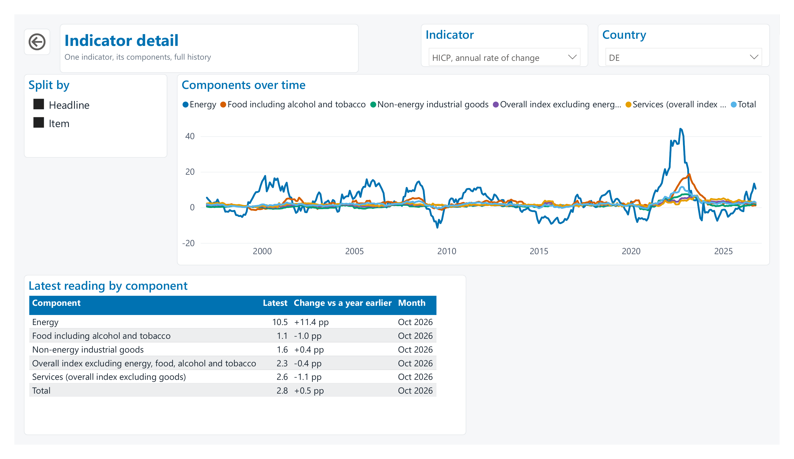

# EU Economy Analytics

Five monthly Eurostat indicators for Germany and five European comparators, from the
Eurostat API through BigQuery to Power BI.




## Pipeline

```
Eurostat API (JSON-stat)
  -> Python ingestion, Pandera validation, pytest
  -> BigQuery
  -> dbt star schema
  -> Power BI (.pbip, TMDL model + PBIR report)
```

Indicators: unemployment, HICP inflation, industrial production, retail trade volume,
consumer confidence. Geographies: Germany, France, Italy, Netherlands, Poland, euro area.

dbt builds against BigQuery or a local DuckDB copy, so the model and its tests run without
cloud credentials.

## Aggregation safety

The fact table holds rates, index levels and survey balances together. None can be summed,
and most cannot be averaged across countries. `dim_series` records how each series may be
combined, and the base measure refuses rather than guesses:

```dax
Value = IF ( COUNTROWS ( fct_observation ) = 1, SELECTEDVALUE ( fct_observation[value] ) )
```

More than one series in scope returns blank. The year on year measures read the unit and
branch: percent change for index series, percentage points for rates and balances.

## Running it

```bash
pip install -r requirements.txt
python -m src.ingest.eurostat --all
python -m src.load.bigquery
cd dbt && dbt build --profiles-dir .
```

Needs `BQ_PROJECT`, `BQ_RAW_DATASET`, `BQ_DBT_DATASET`, `BQ_LOCATION` and Google
application default credentials.

## Notes

- Unemployment is the Eurostat harmonised rate, lower than the Bundesagentur figure.
- Euro area is EA21, back-calculated at fixed composition, so the series is continuous.
- Indicators publish on different schedules, so each card carries its own month.

## Not done yet

Two report pages; country comparison and method pages are outstanding. Destatis regional
data is not wired in.
