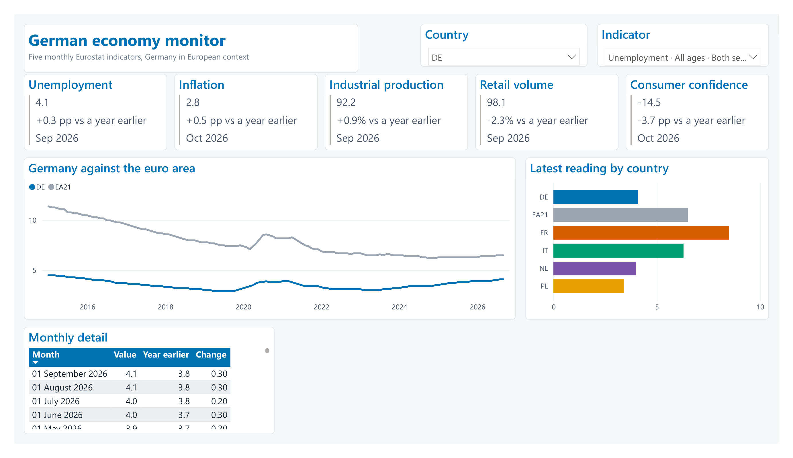
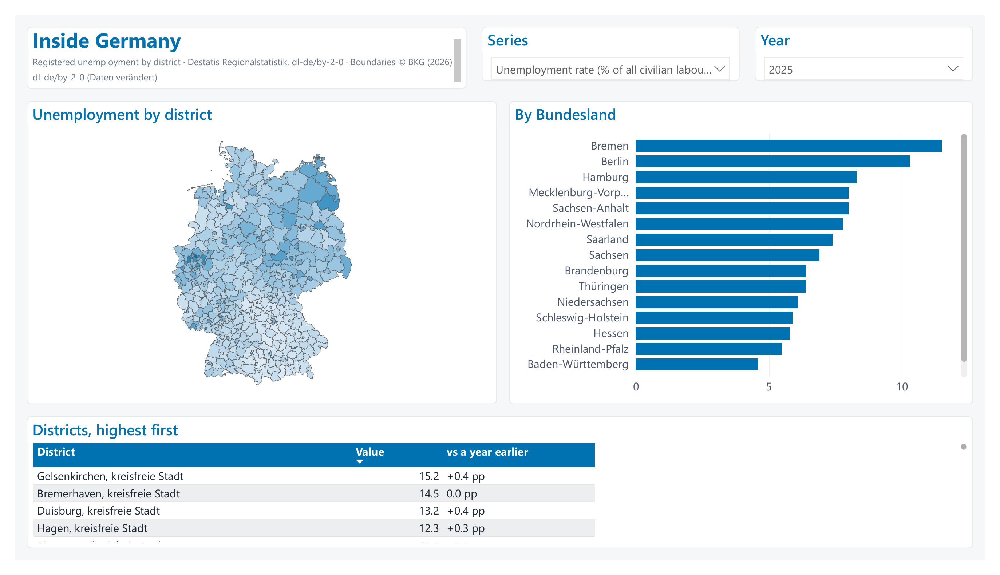
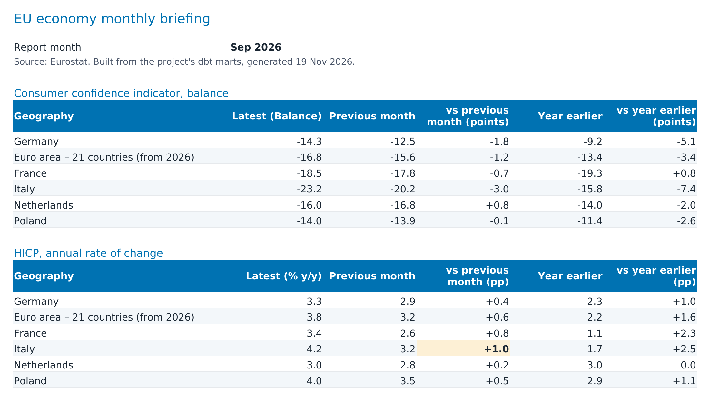
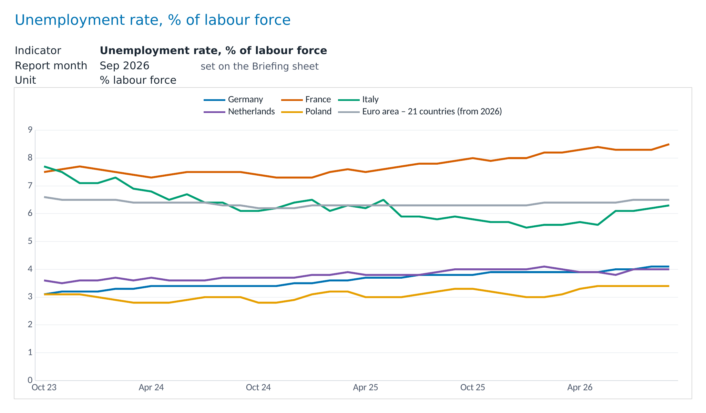

# EU Economy Analytics

Five monthly Eurostat indicators for Germany and five European comparators, plus German
regional unemployment from Destatis, through BigQuery to a Power BI report and an Excel
briefing.






## Pipeline

```
Eurostat API (JSON-stat)          Destatis Regionalstatistik (ffcsv)
  -> Python ingestion, Pandera validation, pytest
  -> BigQuery
  -> dbt star schemas, one monthly and one annual regional
  -> Power BI (.pbip, TMDL model + PBIR report)
  -> Excel briefing (openpyxl, live formulas)
```

Indicators: unemployment, HICP inflation, industrial production, retail trade volume,
consumer confidence. Geographies: Germany, France, Italy, Netherlands, Poland, euro area.

dbt builds against BigQuery or a local DuckDB copy, so the model and its tests run without
cloud credentials.

## Monthly briefing workbook





Python writes a hidden data sheet; every visible number is an INDEX/MATCH formula keyed on
a report month cell, so changing the month recalculates the sheet and the chart. Thresholds
on a Settings sheet are editable, and conditional formatting flags month-on-month moves
beyond them. Country colours match the report.

```bash
python -m src.report.build_workbook
```

## Aggregation safety

The fact table holds rates, index levels and survey balances together. None can be summed,
and most cannot be averaged across countries. `dim_series` records how each series may be
combined, and the base measure refuses rather than guesses:

```dax
Value = IF ( COUNTROWS ( fct_observation ) = 1, SELECTEDVALUE ( fct_observation[value] ) )
```

More than one series in scope returns blank. The year on year measures read the unit and
branch: percent change for index series, percentage points for rates and balances.

## Running it

```bash
pip install -r requirements.txt
python -m src.ingest.eurostat --all
python -m src.load.bigquery
cd dbt && dbt build --profiles-dir .
```

Needs `BQ_PROJECT`, `BQ_RAW_DATASET`, `BQ_DBT_DATASET`, `BQ_LOCATION` and Google
application default credentials.

## Notes

- Unemployment is the Eurostat harmonised rate, lower than the Bundesagentur figure.
- Euro area is EA21, back-calculated at fixed composition, so the series is continuous.
- Indicators publish on different schedules, so each card carries its own month.

## Regional data

Annual registered unemployment for Germany, the 16 Länder and 400 districts, 2015 to 2025,
from Destatis Regionalstatistik table 13211-02-05-4-B. Every level is fetched as published;
nothing is summed or averaged from a lower one. Summing districts gives 2,787,125 for 2024
against a published national figure of 2,787,112, and a test records that difference rather
than hiding it.

Source: Statistisches Bundesamt (Destatis), Regionalstatistik; Datenlizenz by-2-0, eigene
Berechnung.

## District map

`powerbi/maps/vg2500_kreise.topojson` holds the 400 German districts (Kreise) for Power BI's
Shape Map, keyed on the 5-digit AGS as both feature id and `ags` property. It is converted
from BKG's VG2500, Stand 31.12.2025, by `powerbi/maps/build_vg2500_kreise.sh`; the download
itself is not in the repo.

© BKG (2026) dl-de/by-2-0 (Daten verändert), Datenquellen: https://sgx.geodatenzentrum.de/web_public/gdz/datenquellen/datenquellen_vg_nuts.pdf

[BKG](https://www.bkg.bund.de), [dl-de/by-2-0](https://www.govdata.de/dl-de/by-2-0)
